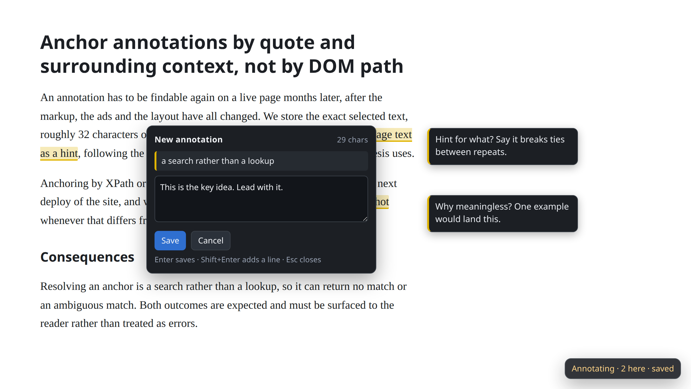
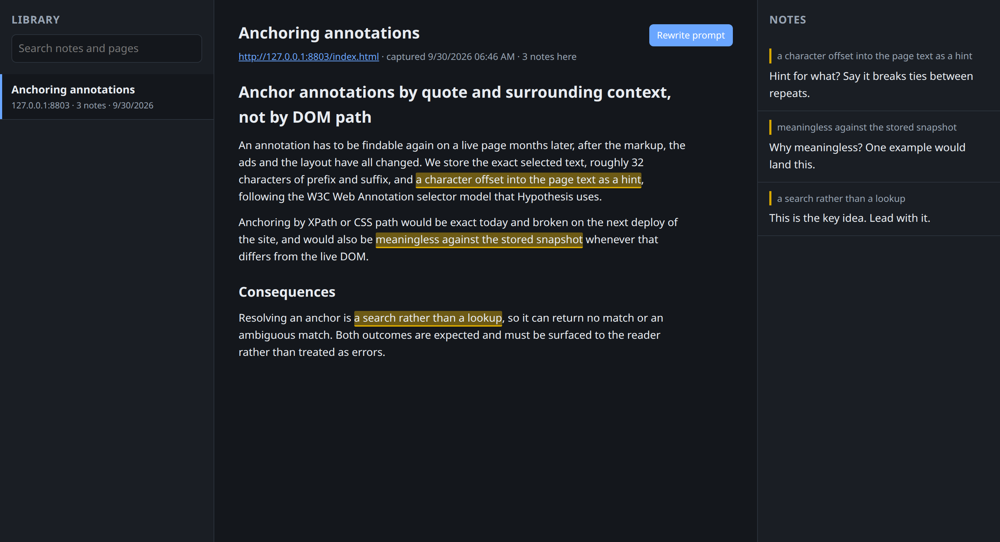

# Comprehension Annotator

Mark the sentences that made you stop while reading. Get back a prompt that
asks a model to rewrite the page so the next reader doesn't stop there.

It is a Chrome extension plus a small local server. Your notes and a copy of
each page stay on your own disk. Nothing is sent anywhere else, and nothing
here calls a model.



## How it works

1. Press `Alt+A` on a page. The tab goes into annotation mode.

2. Select a passage, type why it slowed you down, and press Enter. The note
   appears in the margin next to the passage.

3. Open the library at `http://127.0.0.1:8790/` to read the page back with your
   notes, and press **Rewrite prompt**.



The prompt holds the page, your notes marked in place, and instructions for
the rewrite. Paste it into any model. This is the prompt from the screenshots
above, shortened:

```
**1.** “a character offset into the page text as a hint”
> Hint for what? Say it breaks ties between repeats.

**3.** “a search rather than a lookup”
> This is the key idea. Lead with it.
...
Resolving an anchor is ⟦3⟧a search rather than a lookup⟦/3⟧, so it can return
no match or an ambiguous match.
```

## Install

You need [uv](https://docs.astral.sh/uv/) and Chrome or another Chromium
browser.

**1. Start the local server.**

```
git clone https://github.com/testy-cool/comprehension-annotator
cd comprehension-annotator
uv run python -m sink
```

On first run it creates a token that the extension uses to talk to it. Leave
it running, and print the token from a second terminal:

```
uv run python -m sink --print-token
```

**2. Load the extension.**

Open `chrome://extensions`, turn on **Developer mode**, press **Load
unpacked**, and pick the `extension/` folder. Open the extension's options,
paste the token, and press **Test connection**.

**3. Annotate.** Press `Alt+A` on any page and select some text.

### Keep the server running (Linux)

To have the server start by itself, install it as a systemd user service:

```
packaging/install-service.sh
```

The service can only write to the library and its token folder, and can only
talk to your own machine. Use `packaging/install-service.sh --print` to see
the unit before installing it.

## Things worth knowing

- **Your notes come back.** Reopen an annotated page and its highlights and
  margin notes are drawn again. The first time you press `Alt+A` on a site,
  Chrome asks whether the extension may run there. If you allow it, pages on
  that site with notes are redrawn on load. If you don't, press `Alt+A` to
  bring them back.

- **The extension stays off until you press `Alt+A`.** The only pages it
  starts on by itself are pages that already have your notes, on sites you
  allowed.

- **The server can be down.** Notes wait in the extension and are sent once
  the server is back. The icon shows how many are waiting.

- **Pages change.** Notes are found again by their exact words and the text
  around them, not by page structure. A note whose words are gone is shown as
  missing, not dropped.

- **One address, many pages.** Some sites show different content at the same
  address. Each version is kept as its own snapshot, and each note links to
  the version it was made on.

## Where your data goes

Everything is in `library/` inside the checkout, which git ignores. Set
`ANNOTATOR_LIBRARY` to keep it somewhere else.

```
library/documents/<id>/
  document.json          the address, title and list of snapshots
  annotations.json       your notes
  snapshots/
    <time>-<hash>.html   the page as your browser showed it
    <time>-<hash>.md     readable text taken from that page
```

A page is only stored again when its content has changed.

## From the command line

```
uv run python -m sink list                  every page in the library
uv run python -m sink prompt <page>         the rewrite prompt for one page
```

`<page>` can be the full address, the id from `list`, or enough of the address
to pick one page. The prompt goes to stdout, so it can be piped to any model
CLI.

## Tests

```
uv run pytest                     # the server
pnpm test                         # matching notes to text, and the queue
uv run python tests/e2e/run.py    # the real extension in a real browser
```

The browser test uses its own profile and port, so it doesn't touch your
browser. It needs Brave or Chromium, because current Chrome refuses to load an
extension from the command line. Loading it by hand, as in the install steps,
works in Chrome.

## Not built yet

- Rewriting inside the browser, and anything that calls a model.

- Moving a missing note to the passage that replaced it. Missing notes are
  shown, but fixing one is still manual.

## Further reading

- [CONTEXT.md](CONTEXT.md): what the project's terms mean.

- [docs/design.md](docs/design.md): how the parts fit together.

- [docs/adr/](docs/adr/): why it is built this way.

## License

MIT
